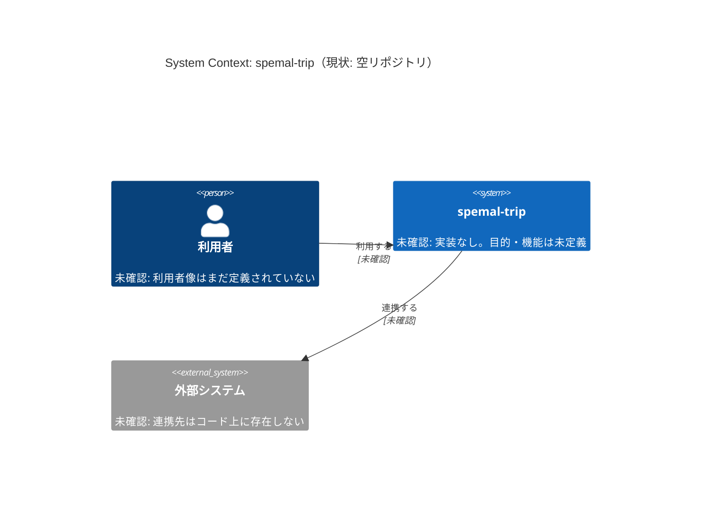
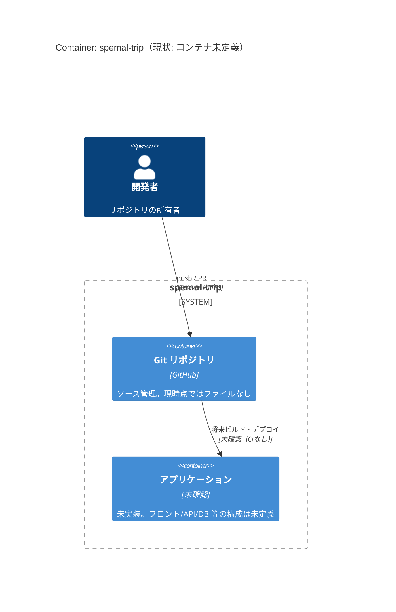
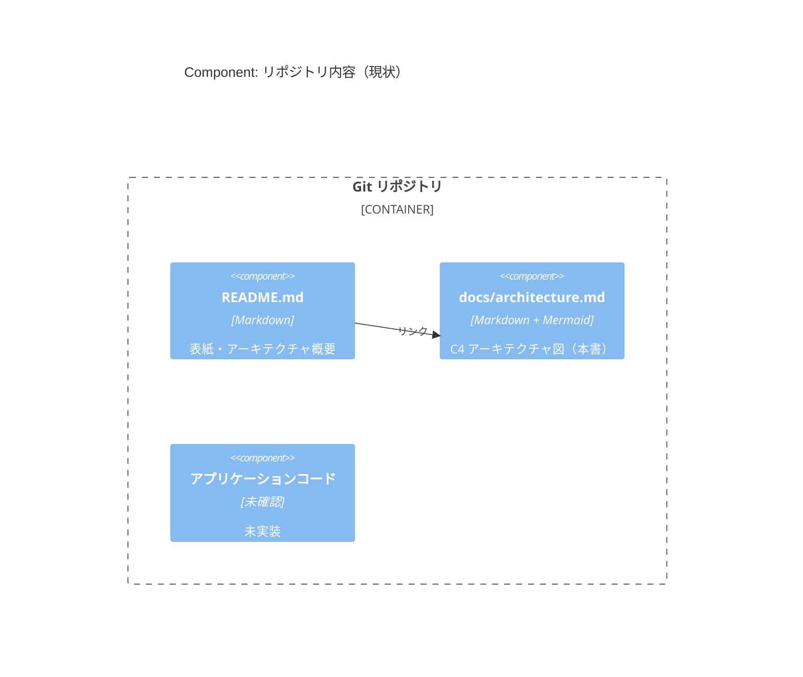
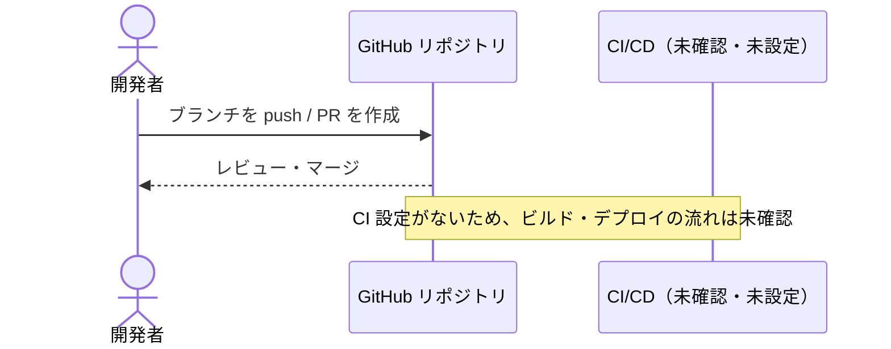

# アーキテクチャ（C4モデル）

> 調査日: 2026-10-31
> 調査対象: `AmonOhno/spemal-trip`（ブランチ・コミットとも存在しない空リポジトリ）

## 0. 調査結果サマリ

このリポジトリには、調査した時点で**ファイルが1つもなく、コミットも0件**でした（`git ls-remote origin` でもリモートブランチは見つかりません）。
そのため、アプリケーションのコード・依存定義・設定ファイル・IaC・Docker・CI はどれも**存在しない**ことが確認できています。

以降の図と表に載せているのは、コードから**確認できた事実だけ**です。リポジトリ名から用途は推測できますが、推測した要素は図に入れていません。
該当する要素はすべて「**未確認**」としています。アプリのコードが追加されたら、このドキュメントを更新してください。

| 調査項目 | 結果 |
| --- | --- |
| README | なし（今回新しく作成） |
| 依存定義（package.json / requirements.txt / pubspec.yaml 等） | なし |
| エントリポイント | なし |
| 設定ファイル / 環境変数定義 | なし |
| IaC（Terraform / CDK 等） | なし |
| Docker / docker-compose | なし |
| CI 設定（.github/workflows 等） | なし |
| 外部API・DB・認証の接続先 | なし（コード上で確認できない） |

## 1. 概要

| 項目 | 内容 |
| --- | --- |
| アプリの目的 | 未確認（リポジトリ名は `spemal-trip` だが、目的を裏付けるコード・文書はない） |
| 主な利用者 | 未確認 |
| 技術スタック | 未確認（言語・フレームワーク・DB・ホスティングのどれも未定義） |

## 2. Level 1: System Context 図



| 名前 | 種別 | 技術 | 責務 |
| --- | --- | --- | --- |
| 利用者 | Person | — | 未確認 |
| spemal-trip | Software System | 未確認 | 未確認（実装なし） |
| 外部システム | External System | 未確認 | 未確認（連携先の定義なし） |

## 3. Level 2: Container 図

コンテナ（フロントエンド / API / DB / ストレージ / バッチ / 外部SaaS など）を構成するコードや設定はありません。
今ある実行単位は「ソースを保管している Git リポジトリ」だけです。



| 名前 | 種別 | 技術 | 責務 |
| --- | --- | --- | --- |
| 開発者 | Person | — | リポジトリの管理 |
| Git リポジトリ | Container（ソース管理） | GitHub | ソースコードの保管（現在は空） |
| アプリケーション | Container | 未確認 | 未実装 |

## 4. Level 3: Component 図

中心となるコンテナが存在しないため、コンポーネント（内部モジュール）は描けません。今回追加したドキュメント類の構成だけを示します。



| 名前 | 種別 | 技術 | 責務 |
| --- | --- | --- | --- |
| README.md | Document | Markdown | リポジトリの表紙と概要図 |
| docs/architecture.md | Document | Markdown / Mermaid | 詳細なアーキテクチャ記述 |
| アプリケーションコード | Component | 未確認 | 未実装 |

## 5. 主要なデータフロー

アプリケーションのデータフローはまだありません。現在確認できる流れは、開発者がリポジトリへ変更を届けるフローだけです。



## 6. ディレクトリ構成

```
spemal-trip/
├── README.md              # 表紙・アーキテクチャ概要（今回追加）
└── docs/
    └── architecture.md    # C4 アーキテクチャ図（本書、今回追加）
```

| パス | 役割 |
| --- | --- |
| `README.md` | リポジトリの説明。冒頭に全体像の図を掲載 |
| `docs/` | 設計ドキュメントの置き場 |

## 7. 今後の更新方針

アプリのコードが追加されたら、次の項目を確認して各図の「未確認」を埋めてください。

- 依存定義から技術スタックを特定する
- エントリポイントと設定ファイルからコンテナ（フロント / API / DB 等）を特定する
- 外部API・認証・DB の接続先を System Context 図と Container 図に反映する
- 中心となるコンテナの内部モジュールを Component 図に反映する
